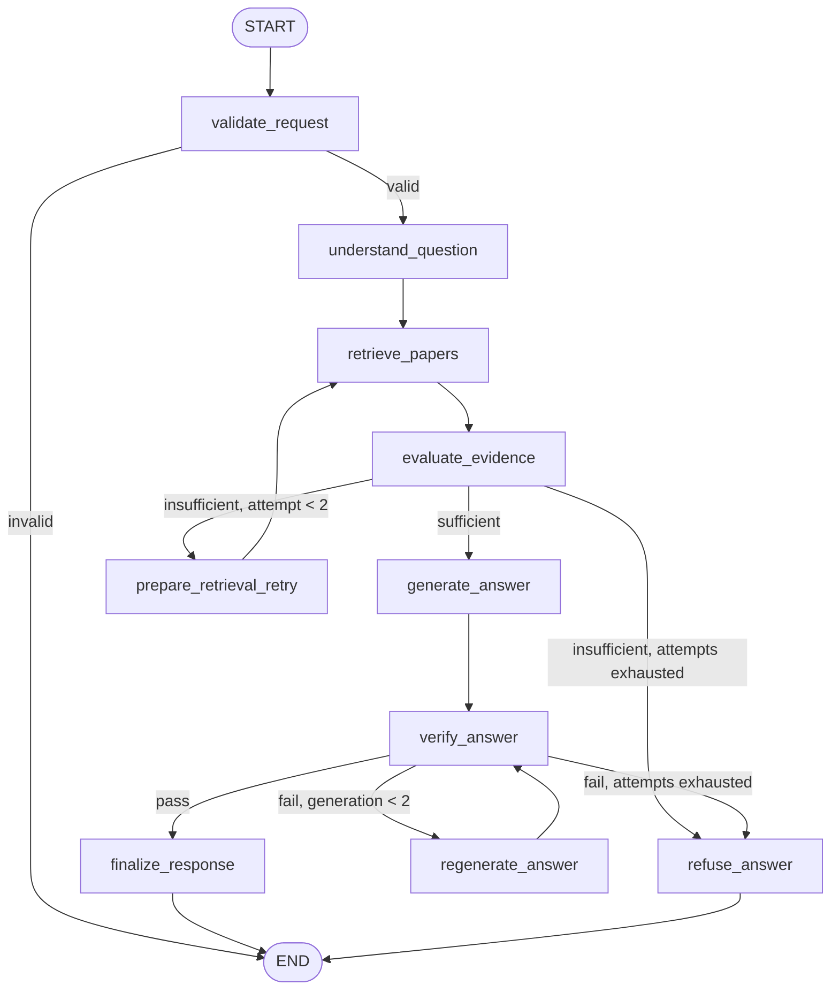

# Agent architecture

## Workflow graph

## Node responsibilities

| Node | Responsibility | Model call |
|---|---|---|
| `validate_request` | Reject empty requests | No |
| `understand_question` | Identify intent and produce a faithful retrieval query | Yes |
| `retrieve_papers` | Configurable BM25, query-expanded paper-aware retrieval, or deterministic lexical reranking over version-pinned paper chunks | Retrieval tool |
| `evaluate_evidence` | Check retrieval scores and lexical overlap | No |
| `prepare_retrieval_retry` | Reform query by removing non-informative stop words | No |
| `generate_answer` | Draft answer from retrieved evidence with chunk-ID citations | Yes |
| `verify_answer` | Validate citation IDs and ask a verifier to assess grounding | Yes when IDs are structurally valid |
| `regenerate_answer` | Make one bounded correction attempt | Yes |
| `refuse_answer` | Return an honest refusal | No |
| `finalize_response` | Convert chunk IDs to paper/version/page citations | No |

## Release policy

Draft answer text is not sent to the user before verification. The current request-level `first_token_ms` is therefore the response-release time after verification, not the internal first-token latency of the generation call. The latter is stored per model call in the graph result. The benchmark report must make this distinction explicit.

## Error policy in this first cut

Provider errors are normalized at the request boundary. A 429 is marked `rate_limited`, a provider timeout is marked `timeout`, and other failures are marked `error`. Provider-level exponential backoff, queue admission, and retry scheduling are deliberately not in this first workflow cut; they belong in the next infrastructure phase and must be tested separately from the graph's retrieval/verification loops.

## Retrieval configuration

The same LangGraph node accepts one of three retrieval strategies: `bm25` (baseline), `expanded` (deterministic query expansion plus paper-topic prior), and `reranked` (adds overlap scoring and an MMR-style redundancy penalty). Chunk size and final `top_k` are independently configurable so the three retrieval experiments can match the brief. The paper-topic prior only influences ranking; it does not filter out any paper.
